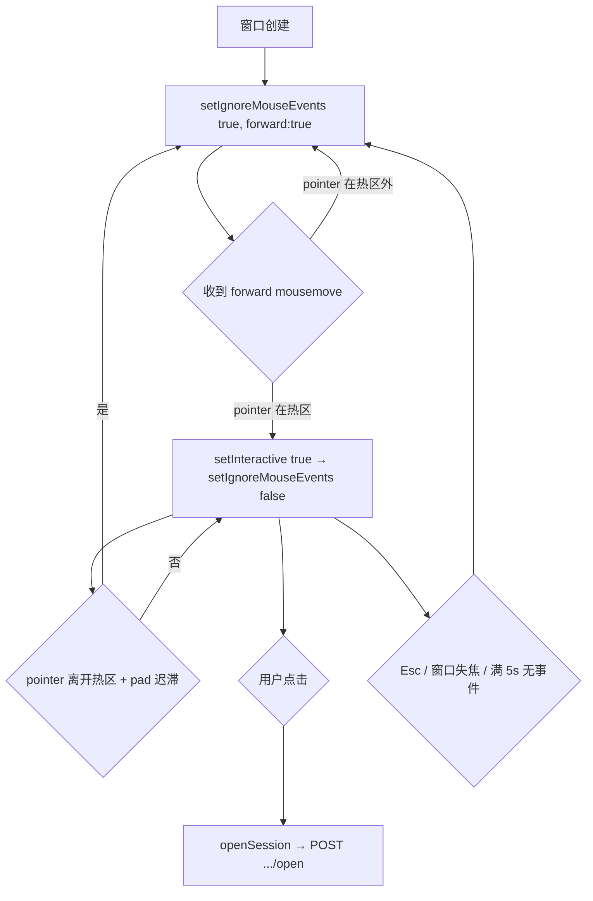

# AgentXRay 桌面宠物壳（`agent-xray-pet`）增量系统设计

> 状态：设计 v0.1 · 2026-10-14
> 范围：PRD §6 的 **P2 / P3 / P4**（P0 `lib/pet-state.js`、P1 `lib/pet-aggregator.js` + `lib/routes/pet.js` + `frontend/src/components/PetWidget.tsx` 已在仓库中，本设计只做增量）。
> 权威规格：`docs/pet-state-prd.md`（§2 非目标 N1–N4、§4 状态机、§6 路线表）。
> 约束：N4（Electron 只做独立子包，绝不进根包）；本沙箱**无法安装/运行 Electron GUI**，因此「一切可判定、可测的逻辑」必须抽成不 `require('electron')` 的纯模块，用根 `npm test`（`node --test test/*.test.js`）覆盖。

---

## 0. 摘要与设计原则

本设计把「桌面宠物」拆成**三层**：一个不依赖 Electron 的 **纯逻辑层**（`desktop/lib/*`，可单测）、一层**极薄的 Electron 胶水**（`main.js` + `preload.js`，共 2 个文件 `require('electron')`）、一层**零构建渲染**（`renderer/*`，纯 HTML + 原生 JS + Canvas，只经 `window.pet` 桥与主进程通信）。

这条边界是硬性交付物，不是建议：

| 目录 | 是否 `require('electron')` | 是否可被 `node --test` 直接 require |
|---|---|---|
| `desktop/lib/*.js` | **否** | **是** |
| `desktop/main.js` | 是 | 否（仅手动/GUI 验收） |
| `desktop/preload.js` | 是 | 否 |
| `desktop/renderer/*` | 否（只用 `window.pet` + DOM/Canvas） | 否（DOM 环境，手工验收） |

延续本项目既有哲学：`lib/open-session.js` 的 `run` 注入、`lib/pet-state.js` 的 `now` 注入、`lib/pet-aggregator.js` 的 `platforms` 注入 —— 桌面壳的每个纯模块同样把「时间 / 网络 / 子进程 / 文件系统」做成可注入依赖。

---

## 1. 方案概述 + 技术选型

### 1.1 为什么是 Electron

需求是 macOS 上一个**透明、无边框、置顶、可点击穿透、常驻**的小窗，内部跑 Canvas 动画。

- **Electron**：原生支持 `transparent: true` / `frame: false` / `alwaysOnTop` / `setIgnoreMouseEvents(true, {forward:true})`；渲染层是 Chromium，Canvas 2D 现成；主进程是 Node，能直接复用 `lib/open-session.js` 同款子进程能力；与项目现有 Node 生态、`node --test`、biome 完全同源。**采纳**。
- **Tauri**：产物小，但要引入 Rust 工具链（第二套构建链），且 macOS 点击穿透/透明窗的成熟度需自证。与「单一 Node 工具链」目标冲突。**否决**。
- **原生 Swift/AppKit**：透明 + 穿透最顺，但等于新建一个非 JS 代码库，脱离项目测试体系。**否决**。
- **纯 Web（浏览器固定窗）**：做不到置顶/透明/穿透，无法满足验收。**否决**（P1 的 `PetWidget.tsx` 已覆盖「web 内 dogfood」这一形态）。

### 1.2 是否引入打包器（renderer）—— 结论：**不引入，renderer 零构建**

**采纳「纯 HTML + 原生 JS（ES modules）+ Canvas 2D」**，理由：

1. 渲染内容只有「一块画布 + 一个可选的拖拽热区 + 可选气泡」，没有组件树、没有路由、没有状态框架。React/Vite 的收益在此趋零。
2. 引入 Vite/webpack 会带来**第二套 node_modules + 第二套构建配置 + 第二套 CI 步骤**，并把子包与根包「一条命令跑测试」的目标打散。
3. 零构建让 `desktop/main.js` 能直接 `loadFile('renderer/index.html')`，也让根 `npm test` 完全不受影响（测试只 require 纯逻辑层）。
4. 根包已有 `build:ui`（`scripts/build-legacy-pure.mjs` + frontend Vite）。**再叠加一套**只会增加心智负担。

**反驳点（如实记录）**：若未来 P4+ 要长出设置面板、皮肤选择器、拖拽布局等复杂 UI，手写 DOM 会变得吃力，届时引入构建是合理的。本设计**显式推迟**该决定，并在 `renderer/` 保持「无框架、易迁移」的写法。同时**不引入 TypeScript**（TS 只存在于 `frontend/`）；desktop 子包用 CommonJS（`lib/`）与浏览器原生 script（`renderer/`），风格对齐 `lib/` + `biome.json`（单引号、分号、行宽 120）。

**纯模块与 renderer 复用**：`desktop/lib/pixel.js` 用**不依赖任何环境**的 UMD 风格（`module.exports` 优先、否则挂 `globalThis.PetPixel`），这样 `renderer/index.html` 用 `<script src="../lib/pixel.js">` 即可复用同一套像素帧算法，而根 `node --test` 又能 `require('../desktop/lib/pixel.js')` 覆盖它。**一套代码，两条通道，零构建。**

### 1.3 进程模型与职责边界

```
┌─────────────────────────── Electron 主进程 (main.js, Node) ───────────────────────────┐
│ · 单实例锁 (app.requestSingleInstanceLock)                                             │
│ · 创建唯一 BrowserWindow（transparent/frameless/alwaysOnTop/show:false→ready-to-show） │
│ · 托盘 Tray（退出 / 安装开机自启 / 打开设置皮肤目录）                                     │
│ · click-through 开关仲裁（唯一调用 setIgnoreMouseEvents 的地方）                         │
│ · 状态传输：以 HTTP+SSE 连 127.0.0.1:3800（Node 原生，无 CORS 问题），经 IPC 推给渲染层     │
│ · 点击跳回：POST .../sessions/:id/open（复用现有路由）                                    │
│ · 看门狗：可选 spawn server.js 并监督；renderer 崩溃后重建窗口                            │
│ · 全屏轮询：osascript probe → 隐藏/恢复窗口                                              │
│ · LaunchAgent 安装/卸载                                                                  │
│ · 依赖注入装配：把纯模块与真实 Node/Electron 实现拼起来（唯一副作用集中地）                  │
└───────────────────────────────────────────────────────────────────────────────────────┘
        │ preload.js (contextBridge → window.pet，contextIsolation:true, nodeIntegration:false)
        ▼
┌─────────────────────────── Renderer (Chromium, renderer/*) ───────────────────────────┐
│ · Canvas 渲染循环 (requestAnimationFrame)                                               │
│ · 内置像素动画 / 精灵图帧选择（复用 lib/pixel.js、lib/sprite.js 的纯逻辑帧选择）           │
│ · 命中测试：把 pointer 位置交给 lib/pixel.js 的 hotZone() → 决定是否请求「可交互」          │
│ · window.pet.onState(cb) 收状态；window.pet.setInteractive(bool)；window.pet.openSession() │
│ · 无 Node、无 electron、无网络（网络/子进程全在主进程）                                     │
└───────────────────────────────────────────────────────────────────────────────────────┘
```

**为什么 SSE 放主进程而不是 renderer**：renderer 若用 `new EventSource('http://127.0.0.1:3800/…')`，页面源自 `file://`（Origin: `null`），而 `server.js` 未设置任何 CORS 头 → 跨源 SSE 会被 Chromium 拦截。放主进程用 Node 原生 HTTP 流即可绕开 CORS，也省掉 `eventsource` 依赖。代价：需要一个纯 SSE 解析器（见 §3.1），已纳入可测范围。

**为什么「点击穿透」的仲裁只在主进程**：`setIgnoreMouseEvents` 是窗口级 API，只能由主进程调用；renderer 只能「表达意图」（pointer 是否在热区），主进程做去抖与仲裁，避免抖动。

---

## 2. 文件清单（`desktop/` 子包完整目录树）

> 每行标注 **[electron]**（`require('electron')`）或 **[纯]**（无 electron，可 `node --test` 覆盖）或 **[renderer]**（浏览器环境，走 `window.pet`）。

```
desktop/
├── package.json                      [—]   子包清单：name=agent-xray-pet, main=main.js, bin=agent-xray-pet,
│                                           scripts（start/verify/agent:install/agent:uninstall），
│                                           electron 只进 optionalDependencies；无运行时 dependencies。
├── README.md                         [—]   安装/运行/手动验收步骤（含 GUI 验收 checklist）、LaunchAgent 用法、皮肤包格式。
├── main.js                           [electron]  Electron 主进程入口：单实例锁、建透明置顶窗、托盘、
│                                           装配所有纯模块（注入真实 http/osascript/spawn）、IPC、看门狗、
│                                           全屏轮询、click-through 仲裁、退出清理。唯一创建窗口处。
├── preload.js                        [electron]  contextBridge 暴露 window.pet = { onState, onStatus,
│                                           setInteractive, openSession, getInfo, onFullscreen }。
├── lib/
│   ├── config.js                     [纯]   环境变量解析 + 路径常量（PET_DIR/PETS_DIR/日志/LAUNCH_AGENT_LABEL）+ PET_STATES 枚举。
│   ├── sse.js                        [纯]   createSseParser()（chunk→{event,data}）+ buildStateUrl() + createStateClient()（HTTP+SSE 连接/解析/退避重连，返回含 lastLiveness()，httpGet 可注入）。
│   ├── watchdog.js                   [纯]   decideWatchdog()：{now, lastLivenessAt, childAlive, restartCount, startedAt, thresholds} → {action,reason,nextBackoffMs}。
│   ├── fullscreen.js                 [纯]   createFullscreenProbe()（osascript，run 可注入）+ parseSizeTuple() + decideHidden()（含恢复去抖）。
│   ├── launchagent.js                [纯]   buildPlist()（纯 XML 生成）+ resolveProgramArgs() + install()/uninstall()（run 可注入）。
│   ├── sprite.js                     [纯]   parseManifest()/scanPacks()/selectPack()/listStateFrames()/resolveFrame()/isPathWithin()：pet.json 校验、
│   │                                        皮肤发现、帧索引、回退内置；**UMD 双通道**（浏览器仅暴露 resolveFrame/triangle/DEFAULT_STATES）。
│   ├── pixel.js                      [纯]   内置像素动画：PALETTE + buildFrame()（帧规范）+ hotZone()（命中热区）；UMD 双通道。
│   └── open-client.js                [纯]   buildOpenRequest()（纯）+ createOpenClient()：复用 POST .../sessions/:id/open（httpRequest 可注入）。
├── bin/
│   ├── install-agent.js              [—]    `agent-xray-pet install-agent` / `uninstall-agent`：调用 lib/launchagent.js，
│                                           定位 electron 可执行文件，打印 plist 路径与 launchctl 结果。
│   └── verify.js                     [—]    无 GUI 环境自检：加载 lib/* 纯模块跑冒烟（供 CI / 无 Electron 环境降级验证）。
└── renderer/
    ├── index.html                    [renderer]  透明页面骨架 + CSP + 按序引入 pixel.js / sprite-render.js / pet.js。
    ├── pet.js                        [renderer]  渲染入口：requestAnimationFrame 循环、消费 window.pet.onState、
    │                                            pointer 命中→setInteractive、click→openSession、拖拽移动。
    ├── sprite-render.js              [renderer]  调 globalThis.PetSprite.resolveFrame 选帧绘到 canvas + 皮肤加载（ 解码 PNG）+ ctx 适配；
    │                                            index===-1 → 回退 PetPixel.buildFrame（内置像素），不得画空白。
    └── styles.css                    [renderer]  透明底 + 无滚动条 + 禁用文本选择 / 拖拽。

test/                                 [纯]   （根目录，沿用 npm test 的 glob）
├── pet-shell-config.test.js                 config 默认值/环境变量覆盖/路径基于 HOME。
├── pet-shell-sse.test.js                    createSseParser 分帧；createStateClient 用 fake http 覆盖 连接/state 事件/断线退避/lastLiveness/stop。
├── pet-shell-watchdog.test.js               decideWatchdog 全分支（启动宽限/健康/崩溃/假死/退避/上限 giveup）。
├── pet-shell-fullscreen.test.js             parseSizeTuple + decideHidden（全屏/恢复延迟/从未全屏 null/去抖防抖）。
├── pet-shell-launchagent.test.js            buildPlist 结构与转义 + resolveProgramArgs(dev/packaged/override) + install/uninstall（fake run）。
├── pet-shell-sprite.test.js                 parseManifest 校验错误信息 + resolveFrame 帧索引/loop/pingpong + listStateFrames 自然序 + scanPacks/selectPack 回退。
├── pet-shell-pixel.test.js                  buildFrame 状态→视觉参数/hotZone 命中 + 与 PET_META 映射一致。
└── pet-shell-openclient.test.js             buildOpenRequest 平台分派（openclaw 特例）+ createOpenClient（fake http）。
```

**未新增 `docs/sequence-diagram.mermaid` / `docs/class-diagram.mermaid`**：主理人明确要求「不要修改除 `docs/pet-shell-design.md` 以外的任何文件」，故两张 Mermaid 图内嵌于本文 §3/§4。

---

## 3. 数据结构与接口（真实函数签名）

> 以下均为**新定义的接口**（实现交工程师）。签名用 JSDoc 风格；返回对象字段一律显式。所有纯模块 `module.exports = { … }`。仅列关键签名，不写实现。

### 3.1 状态客户端 `desktop/lib/sse.js`

```js
// 纯 SSE 分帧器：把任意 chunk 累积、按 \n\n 切事件，解析 event:/data: 行。
createSseParser()
  => {
    feed(chunk: string): Array<{ event: string, data: string }>,  // event 缺省为 'message'
    reset(): void,
  }

// 纯 URL 构造
buildStateUrl({ host, port, window, interval }) => string
  // => `http://${host}:${port}/api/pet/state?window=${window}&interval=${interval}`

// 状态客户端：主进程内以 Node HTTP + SSE 消费 /api/pet/state；断线指数退避重连。
createStateClient({
  host = process.env.AGENTXRAY_PET_HOST || '127.0.0.1',
  port = Number(process.env.AGENTXRAY_PET_PORT) || 3800,
  window = 180,                       // 秒，对应后端 query
  interval = 2000,                    // ms，对应后端 query
  httpGet = require('http').get,      // 可注入：与 { host,port,path,headers } 兼容的实现
  now = () => Date.now(),
  reconnect = { baseMs: 1000, maxMs: 30000, jitter: 0.2 },
  onState,                            // (petState: PetState) => void
  onError,                            // (err: Error) => void           // 含 error 事件与连接异常
  onStatus,                           // ({ connected: boolean }) => void
})
  => {
    start(): void,                    // 发起连接 → 收 'state' 事件 → onState(JSON.parse(data))
    stop(): void,                     // 主动关闭 socket、清退避定时器
    last(): PetState | null,          // 最近一次成功解析的状态
    lastLiveness(): number | null,    // 最近一次「后端存活」证据时间（成功 GET /api/version 或收到任一 SSE 帧）的 epoch ms；从未→null
    isConnected(): boolean,
  }
```

> **`lastLiveness()` 是 `external-server` 模式下 `decideWatchdog` 的 `lastLivenessAt` 唯一来源**——见 §3.2。没有它，`main.js` 无法给 `decideWatchdog` 喂 `lastLivenessAt`。（本条为「引用字段必须在签名中存在」自查项。）

**约定 / 行为**：
- `PetState` 形状复用现有 SSE payload：`{ state, platform, sessionId, agent, bubble, updatedAt }`（见 `lib/routes/pet.js` 与 `frontend/src/api/types.ts` 的 `PetState`）。`platform/sessionId/agent` 可能为 `null`。
- 收到后端 `event: error` → `onError(new Error(data.error))`，**不**断开连接（后端仅 momentary 错误）。
- 后端 15s `: ping` 心跳 → 解析器产出 `event:'__ping__'`（或无 `data:` 的注释）应被忽略，但**刷新**「最后活动时间」用于假死判定。
- 连接建立/断开 → `onStatus({connected})`；`onStatus` 用于托盘图标与看门狗联动。
- **重连策略**：socket `error`/`close` → 清定时器，`delay = min(maxMs, baseMs * 2^attempt) * (1 ± jitter)`，重连；收到首帧后 `attempt=0`。`stop()` 后不再重连。
- 畸形帧（`JSON.parse` 抛错）→ 丢弃该帧并 `onError`，不影响连接。

### 3.2 看门狗 `desktop/lib/watchdog.js`（纯决策）

```js
decideWatchdog({
  now,                          // epoch ms
  startedAt,                    // 本轮看门狗会话的启动 epoch ms（main.js 建窗时记录并传入）；调用方未提供→null
  lastLivenessAt,               // 最近一次「后端存活」证据时间（成功 HTTP /api/version 或收到任一 SSE 帧，即 sse.js 的 lastLiveness()）；unknown→null
  childAlive,                   // 被监督子进程是否仍在运行（外部 server 模式恒为 true）
  restartCount,                 // 本会话内已重启次数
  thresholds = {
    stallMs: 20000,             // 超过此时长无 liveness → 视为假死
    startupGraceMs: 8000,       // 首次启动宽限（仅在「childAlive 且尚无 liveness 且已给出 startedAt」时生效）
    maxRestarts: 5,             // 超过则 giveup，避免无限重启风暴
    backoffBaseMs: 1000,
    backoffMaxMs: 30000,
  },
})
  => { action: 'ok' | 'restart' | 'giveup',
       reason: string,           // 'healthy' | 'child-exited' | 'hung' | 'max-restarts' | 'startup-grace'
       nextBackoffMs?: number }  // 仅 action==='restart' 时给出
```

**决策规则（顺序）**：

| # | 条件 | action | reason |
|---|---|---|---|
| 1 | `childAlive === true` **且** `lastLivenessAt === null` **且** `startedAt !== null` **且** `now - startedAt <= startupGraceMs` | `ok` | `startup-grace` |
| 2 | `childAlive && lastLivenessAt != null && now - lastLivenessAt <= stallMs` | `ok` | `healthy` |
| 3 | `!childAlive` 且 `restartCount >= maxRestarts` | `giveup` | `max-restarts` |
| 4 | `!childAlive` | `restart` | `child-exited` |
| 5 | `childAlive` 但 `now - lastLivenessAt > stallMs` 且 `restartCount >= maxRestarts` | `giveup` | `max-restarts` |
| 6 | `childAlive` 但 liveness 过期 | `restart` | `hung` |
| 7 | 其余 | `ok` | `healthy` |

> **规则 1 的三个条件是「与」关系，缺一即落到规则 3–7**（后来者勿删条件）。这是修复「启动即崩永不重启」缺陷的关键：`childAlive` 门控 + `startedAt` 时间上界二者缺一都会让规则 1 误吞崩溃。

**两条兜底语义（必须实现，否则打穿 P3 验收「崩溃自拉」）**：
- **子进程在首次产生 liveness 之前就崩掉**：`childAlive === false` 且 `lastLivenessAt === null` → 规则 1 因 `childAlive===true` 不成立而**跳过**，落到规则 4 → `restart` / `child-exited`。（历史缺陷：旧规则 1 只看 `lastLivenessAt==null`，会抢先返回 `ok` 且 `restartCount` 永远为 0 → **永久不重启**。）
- **调用方未提供 `startedAt`（`null`）**：规则 1 的 `startedAt !== null` 不成立 → `startup-grace` 不生效；此时 `lastLivenessAt === null` 一律视为「liveness 过期」，由规则 5/6 处理 → `restart` / `hung`（保证 `external-server` 模式下「后端不可达」不会永远静默返回 `ok`）。

`nextBackoffMs = min(backoffMaxMs, backoffBaseMs * 2**restartCount)`。**纯函数、无副作用**；实际 kill/spawn 由 `main.js` 执行。`main.js` 需在 `action==='restart'` 时 `await sleep(nextBackoffMs)` 后再重启，并在成功 liveness 后把 `restartCount` 归零、把新一次重启的 `startedAt` 更新为当前时刻。

**两种模式**（main.js 装配）：
- **own-server 模式**（推荐给「只想开宠物」的用户）：宠物启动时探测 3800 是否已被占用；未占用则 `spawn(process.execPath, [repoRoot/server.js])`，`childAlive` = 子进程未退出，liveness = 周期性 `GET /api/version`。崩溃/假死 → 重启（含退避）。
- **external-server 模式**（用户已自行 `agentxray` 起服务）：不 spawn，`childAlive=true`；liveness 来自 SSE 帧。假死判定仍然生效；重启动作退化为「重建 SSE 连接 + 重试 HTTP」，连续失败达上限 → `giveup`（托盘提示「后端不可达」）。

**renderer 崩溃**不走 `decideWatchdog`，直接由主进程 `webContents.on('render-process-gone')` → 重建/重载窗口（无损，状态由 SSE 重推）。这条独立于本模块，写进 `main.js`。

### 3.3 全屏检测 `desktop/lib/fullscreen.js`

```js
// 解析 osascript 返回的 "w, h" 或 "{w, h}" / "w,h" 文本
parseSizeTuple(text: string) => { w: number, h: number } | null

// 可注入 probe：默认经 osascript 查「最前台应用的前窗尺寸」与「主屏尺寸」
createFullscreenProbe({
  run = runCommand,                 // 与 lib/open-session.js 同款可注入 runner（execFile 封装）
  isMac = process.platform === 'darwin',
  screenSize,                       // 不注入则经 osascript 查桌面 bounds；测试注入固定值
})
  => () => Promise<{
       fullscreen: boolean,
       appWin?: { w: number, h: number } | null,
       screen?: { w: number, h: number } | null,
       error?: string,
     }>

// 纯判定：把 probe 结果 + 时间冷却成「是否隐藏」
decideHidden({
  probeResult,                      // 上一步 probe 的返回
  now,
  lastFullscreenAt,                 // 最近一次观察到全屏的时间（无→null）
  prevHidden,                       // 上一轮是否隐藏
  thresholds = { resumeDelayMs: 1500 },  // 全屏结束后延迟恢复，防抖
})
  => { hidden: boolean,
       reason: string }             // 'fullscreen' | 'resume-delay' | 'not-fullscreen' | 'probe-error'
```

**判定规则**：
- `probeResult.fullscreen === true` → `{hidden:true, reason:'fullscreen'}`；`main.js` 记录 `lastFullscreenAt=now`。
- `lastFullscreenAt === null`（从未观察到全屏）→ 直接 `{hidden:false, reason:'not-fullscreen'}`，**不做 `now - lastFullscreenAt` 运算**（避免 `now - null` 误判）。
- `fullscreen === false` 且 `lastFullscreenAt !== null` 且 `now - lastFullscreenAt < resumeDelayMs` → `{hidden:true, reason:'resume-delay'}`（保持隐藏，避免退出全屏瞬间闪烁）。
- `fullscreen === false` → `{hidden:false}`。
- probe 抛错 / 权限不足 → **视为不隐藏**（`reason:'probe-error'`），仅首次 `console.warn` 一次，绝不影响主功能。

**probe 具体做法（macOS）**：经 `osascript` 用 System Events 取「最前台进程的前窗 size」，与本机主屏 bounds（或 `scaleFactor` 归一后的逻辑尺寸）比较；`appWin.h >= screen.h`（或覆盖菜单栏区域）判定全屏。**注意**：System Events 需要「系统设置 → 隐私与安全性 → 辅助功能/自动化」授权，与 `lib/open-session.js` 的 `openInTerminal`（`osascript`）同源风险，文档里写清。非 macOS → probe 直接返回 `{fullscreen:false, error:'unsupported'}`。

**轮询策略**：`main.js` 每 `pollMs`（默认 1000ms，可被 `AGENTXRAY_PET_DEBUG` 调快）调一次 probe → `decideHidden` → 变化时才 `win.hide()`/`win.showInactive()`（隐藏时停渲染循环省电，恢复时重启）。

### 3.4 LaunchAgent `desktop/lib/launchagent.js`

```js
// 纯：把参数渲染成 launchd plist XML 字符串（转义 & < >）
buildPlist({
  label,                 // 例如 'com.agentxray.pet'
  programArgs,           // string[]，ProgramArguments（至少 1 项）
  workingDir,            // WorkingDirectory（可选）
  stdoutPath, stderrPath,// StandardOutPath / StandardErrorPath（可选）
  keepAlive = true,      // KeepAlive
  runAtLoad = true,      // RunAtLoad
  processType,           // 'Interactive' | 'Background' | …（可选，默认 Background）
})
  => string              // 完整 <plist>…</plist>（UTF-8 XML）

// 纯：决定 LaunchAgent 该拉起的可执行 + 参数
resolveProgramArgs({
  mode,                  // 'dev' | 'packaged'
  execPath = process.execPath,     // 运行 installer 时的可执行（Electron 下=Electron 二进制；纯 node 下=node）
  desktopDir,            // <repo>/desktop 的绝对路径
  appBundle,             // packaged 模式：'/Applications/AgentXRay Pet.app' 之类
  override,              // process.env.AGENTXRAY_PET_EXEC，最高优先级
})
  => { programArgs: string[], resolvedMode: 'dev'|'packaged'|'override', warning?: string }

// 纯 + 可注入 run：安装（先 unload 再写 plist 再 load）/ 卸载
install({ label, plist, plistDir, run })  => Promise<{ ok, plistPath, error? }>
uninstall({ label, plistDir, run })       => Promise<{ ok, error? }>
```

**具体取值**：
- `label = 'com.agentxray.pet'`（常量 `LAUNCH_AGENT_LABEL`）。
- plist 路径：`~/Library/LaunchAgents/com.agentxray.pet.plist`。
- 日志：`StandardOutPath = ~/.agentxray/pet/pet.log`、`StandardErrorPath = ~/.agentxray/pet/pet.err.log`（**与既有 `~/.agentxray/` 数据目录约定一致**，见 `lib/config.js`）。
- `ProgramArguments`：
  - `mode='packaged'`：`['<appBundle>/Contents/MacOS/agent-xray-pet']`（打包产物的真实可执行）。
  - `mode='dev'`：`[execPath, '<desktopDir>/main.js']`，其中 `execPath` 应是 **Electron 二进制**（在 Electron 内运行时 `process.execPath` 即它）。
  - **纯 node 下运行 installer 的护栏**：若检测到 `execPath` 是 `node`（非 Electron）且无 `AGENTXRAY_PET_EXEC` 覆盖 → 返回 `warning` 并拒绝安装（因为 `node main.js` 会因 `require('electron')` 失败）。这保证不会写出一个必然崩溃的 agent。
  - 环境覆盖 `AGENTXRAY_PET_EXEC` 直接作为 `programArgs[0]`，`resolvedMode='override'`。
- 命令执行（`run` 注入，默认 `execFile`）：`launchctl unload -w <plist>` → 写文件 → `launchctl load -w <plist>`（卸载反之）。`run` 可注入以便单测断言命令行。

### 3.5 精灵图包 `desktop/lib/sprite.js`（P4）

**`pet.json` 字段定义（JSON Schema 级）**：

```
pet.json
├─ name      : string, 必填, 1–64 字            # 皮肤显示名
├─ version   : integer, 可选, 默认 1             # 包格式版本（本设计只认 1）
├─ fps       : number,  必填, 1–60             # 全局帧率
├─ loop      : boolean, 可选, 默认 true          # 全局循环
├─ scale     : integer, 可选, 默认 2, 1–8        # 像素放大倍数
├─ anchor    : { x:number(0–1), y:number(0–1) }, 可选, 默认 {x:0.5,y:1.0}  # 帧内锚点
└─ states    : object,  可选                    # 键必须是 PetStateName 的子集，未知键→warning
   └─ "<state>": {
        dir      : string, 可选, 默认 "frames/<state>"   # 相对 pet.json 的目录（禁止 .. 逃逸）
        fps      : number, 可选, 1–60                   # 覆盖全局 fps
        loop     : boolean,可选, 默认继承全局
        pingpong : boolean,可选, 默认 false              # 往复播放
      }
```

目录约定（PRD 固定）：帧文件位于 `frames/<state>/*.png`，**文件名自然序**（numeric-aware）即播放顺序。校验时若某 state 无帧文件 → 该 state 视为「未覆盖」，渲染回退内置像素。

**模块边界（与 `pixel.js` 完全同款 UMD 双通道）**：`sprite.js` 因内部 `require('node:path')`/`require('fs')` 属 Node 模块，**renderer 的 `<script>` 加载不了**；因此必须写成 UMD：
- **Node 通道**（`module.exports`）：保持下面全部导出（`parseManifest`/`scanPacks`/`selectPack`/`listStateFrames`/`resolveFrame`/`triangle`/`isPathWithin`/`DEFAULT_STATES`）。
- **浏览器通道**（`<script>` 下挂 `globalThis.PetSprite`）：**只挂 `{ resolveFrame, triangle, DEFAULT_STATES }`** —— 这三个是纯计算、不碰 fs/path，可在 renderer 直接跑。
- **`parseManifest` / `scanPacks` / `selectPack` / `listStateFrames` / `isPathWithin` 保持 Node-only，不得进浏览器通道**（它们依赖 fs/path）。主进程负责「扫盘 + 校验」，把结果经 IPC 下发（见下方 payload）。

```js
// —— Node-only ——
// 纯校验：raw 是 UTF-8 字符串；dir 用于把相对路径解析成绝对并做逃逸检查
parseManifest(raw, { dir, states = PET_STATES })
  => { ok: boolean,
       manifest: NormalizedManifest | null,
       errors: string[],            // 人话错误，如 'pet.json: "fps" 必须是 1–60 的数字'
       warnings: string[] }         // 未知 state 键 / 未识别的字段

// 纯：扫描 ~/.agentxray/pets/<name>/pet.json，返回可用皮肤列表（fs 可注入）
scanPacks(petsDir, { fs = require('fs'), states = PET_STATES })
  => Promise<Array<{ name, path, manifest, mtimeMs }>>   // 校验失败的被跳过并记 warning

// 纯：选择要用的皮肤（优先级）
selectPack({ requested, packs, fallback = 'builtin' })
  => { source: 'requested' | 'first' | 'recent' | 'builtin', pack?: Pack }

// 纯：列出某 state 目录下的帧（主进程扫描皮肤、下发 renderer 的唯一入口）
listStateFrames(stateDir, { fs = require('fs') })
  => Promise<string[]>             // 该目录下 *.png 的**绝对路径**，按**自然序**（numeric-aware）排序；目录不存在→[]

// —— 浏览器 + Node 双通道（可进 globalThis.PetSprite）——
// 纯：给定皮肤 + 状态 + 已播放时长 → 帧索引
resolveFrame(manifest, state, elapsedMs, frameCount)
  => { index: number, fps: number, loop: boolean, pingpong: boolean }   // frameCount<=0 → index:-1
triangle(n, m) => number             // m<=1 → 0；period=2*(m-1)
DEFAULT_STATES: PetStateName[]       // 6 态常量
```

**`resolveFrame` 算法（纯、可测）**：
- 取该 state 的 config（fps/loop/pingpong），无则回退 manifest 全局值；`frameCount<=0` → `{index:-1}`（调用方回退内置）。
- `raw = floor(elapsedMs / 1000 * fps)`。
- `loop=true`：`index = pingpong ? triangle(raw, frameCount) : raw % frameCount`。
- `loop=false`：`index = min(raw, frameCount-1)`（停在末帧）。
- `triangle(n, m)`：`period=2*(m-1)`（m>1），`n % period < m ? n%period : period - n%period`；`m<=1` → 0。

**优先级（「无自定义皮肤 → 回退内置像素动画」）**：
1. `AGENTXRAY_PET_PACK`（皮肤名或绝对路径）存在且校验通过 → **requested**。
2. 否则 `~/.agentxray/pets/` 下存在皮肤 → 取**最近修改**的一套（`recent`；都算不出则按名字典序取第一个 `first`）。
3. 否则 → **builtin**（内置像素动画 §3.6）。
- 任一自定义皮肤校验失败 → 记 `warn` 并跳过，绝不 crash；坏皮肤不影响内置可用。

**皮肤 IPC payload（main → renderer，供 `preload.js`/`pet.js` 对齐）**：

```
payload = {
  manifest: NormalizedManifest | null,        // parseManifest 的产物；无自定义皮肤/校验失败 → null
  frames:   Record<PetStateName, string[]>    // 每个 state → 帧图片绝对路径数组（listStateFrames 产出）；缺失的 state → []
}
```
- 下发通道：启动时用 `pet:get-info` 的返回值携带；运行中热换肤用主进程 push `pet:skin`（同一 payload）。两者形状**必须一致**。
- renderer 消费规则：
  - `manifest === null`（含 builtin 模式）→ 全部 state 走 `PetPixel.buildFrame` 内置像素。
  - 某 state 的 `frames[state].length === 0` → **该 state** 回退内置像素（其余 state 仍用皮肤，逐 state 混合）。
  - 否则 `index = PetSprite.resolveFrame(manifest, state, elapsedMs, frames[state].length).index`。
- **`resolveFrame` 返回 `index === -1`（即 `frameCount<=0`）时的 renderer 行为：回退内置像素动画 `PetPixel.buildFrame`，不得画出空白**（这是「无自定义皮肤 → 回退内置」在逐帧路径上的落点）。

> **代码卫生（供工程师顺手修）**：`desktop/lib/sprite.js` 中的 `// eslint-disable-next-line no-console` 无效且误导——本仓库使用 **biome**（见 `biome.json`），不识别 eslint 指令。请改用 biome 的抑制注释（`// biome-ignore lint/...: <理由>`）或直接移除该 console 调用。

### 3.6 内置像素动画 `desktop/lib/pixel.js`（P2，零图片）

**画法（零图片资源）**：在 16×16 逻辑像素网格上，用「帧规范」描述要画的矩形/圆点，renderer 用 Canvas `fillRect`/`arc` 逐格落笔（`imageSmoothingEnabled=false` 放大，得到像素风）。

```js
PALETTE: Record<PetStateName, { base: string, accent: string, eye: string, mood: string }>
// 对齐 frontend/src/components/PetWidget.tsx 的 PET_META 色系：
//  idle → slate ; thinking → sky ; working → amber ; done → emerald ;
//  waiting_input → red(pulse) ; error → red(pulse)

// 纯：输出「帧规范」——一组待绘制图元 + 弹跳/脉冲参数；不含任何 canvas API
buildFrame({
  state,                 // PetStateName
  elapsedMs,             // 已播放时长（驱动动画相位）
  geom = { w: 64, h: 64, cell: 4 },   // 画布逻辑尺寸与像素格
  grid = 16,             // 逻辑网格边长
})
  => {
       cells: Array<{ x, y, w, h, color }>,   // 逻辑网格坐标（未乘 cell）
       bubbleAnchor: { x, y },                // 气泡锚点（逻辑坐标）
       hitCells: Array<{ x, y, w, h }>,       // 参与命中的不透明格（供 hotZone）
       bounceY: number,                       // 竖向弹跳偏移（px，已含在渲染时）
       pulse: boolean,                        // waiting_input/error 的脉冲环
     }

// 纯：pointer → 是否落在宠物热区（命中测试，供 click-through 仲裁）
hotZone(frameSpec, { pointer: { x, y }, cell = 4, pad = 8 })
  => boolean

// 双通道导出（UMD）：node 下 module.exports；浏览器 <script> 下挂 globalThis.PetPixel
```

**状态 → 视觉参数映射表（对齐 `PET_META`）**：

| state | base/accent（色系） | 动画 | 命中 |
|---|---|---|---|
| idle | slate / slate-400 | 缓慢呼吸（`bounceY` 正弦 ±1px，低频） | 本体格 |
| thinking | sky / sky-300 | 头部轻微倾斜 + 头顶三点「…」闪烁 | 本体格 |
| working | amber / amber-300 | 环绕一个旋转点（相位=`elapsedMs`） | 本体格 |
| done | emerald / emerald-300 | 短暂「✓」弹出（首 800ms 高亮，之后回到本体） | 本体格 + 对勾 |
| waiting_input | red-500 / red-300 | 明显上下弹跳（`bounceY` 大幅）+ 脉冲环 | 本体格（`pulse:true`，热区放大 `pad`） |
| error | red-600 / red-300 | 左右抖动 + 脉冲环 | 同 waiting_input |

`pulse` 的两种状态（`waiting_input`/`error`）是 G2 的最高价值信号，故额外放大命中区（便于点中）并触发脉冲。

### 3.7 点击跳回 `desktop/lib/open-client.js`（P3，复用现有路由）

```js
// 纯：构造与现有路由匹配的请求（不改后端）
buildOpenRequest({ platform, sessionId, agent, action = 'open' })
  => { method: 'POST',
       path: string,          // openclaw → `/api/agents/${agent}/sessions/${sessionId}/open`
                              // 其它     → `/api/${platform}/sessions/${sessionId}/open`
       body: { action } }

// 可注入 transport：真正发起请求（默认 Node http.request 到 host:port）
createOpenClient({
  host = process.env.AGENTXRAY_PET_HOST || '127.0.0.1',
  port = Number(process.env.AGENTXRAY_PET_PORT) || 3800,
  httpRequest,               // 可注入：(opts, cb) 兼容 http.request
  onResult,                  // (result: OpenSessionResult) => void
  onError,                   // (err: Error) => void
})
  => {
    open({ platform, sessionId, agent, action }): Promise<OpenSessionResult>,
    locate({ platform, sessionId, agent }): Promise<OpenSessionResult>,
    copyFallback(result): string | null,   // 返回 fallback.path/command 供剪贴板
  }
```

- 响应形状即现有契约：`{ ok, action, detail }` 或 `{ ok:false, error, fallback:{type:'copy-path'|'copy-command', path?/command?} }`（见 `lib/routes/sessions.js` / `frontend/src/api/types.ts` 的 `OpenSessionResult`）。
- **N1 落地**：点击**只**发 `action:'open'`/`'locate'`，**永不**携带任何内容回复；`fallback` 交给系统剪贴板（`clipboard.writeText`，主进程 `electron.clipboard`）。
- openclaw 特例：`sessionId` 来自聚合器时，若 `PetState.agent` 非空，走 `/api/agents/:agent/sessions/:id/open`；与 `frontend/src/api/client.ts` 的 `openSession()` 判断完全一致。

---

## 4. 程序调用流程

### 4.1 (a) 启动 → 建窗 → 连 SSE → 渲染循环 → 看门狗

```mermaid
sequenceDiagram
  autonumber
  participant LA as LaunchAgent / 用户
  participant M as main.js (主进程)
  participant W as BrowserWindow
  participant R as renderer/pet.js
  participant SC as lib/sse.js createStateClient
  participant BK as server.js (127.0.0.1:3800)
  participant WD as lib/watchdog.js

  LA->>M: 启动 agent-xray-pet
  M->>M: requestSingleInstanceLock()
  M->>M: 读 config（PID_DIR/PETS_DIR/HOST/PORT）
  M->>BK: (own-server 模式) 探测端口 / spawn server.js
  M->>W: new BrowserWindow({transparent,frameless,alwaysOnTop,skipTaskbar})
  M->>W: loadFile(renderer/index.html)
  W->>R: DOM ready
  R->>W: window.pet.getInfo() → {manifest, frames, geom, state}（皮肤 payload，见 §3.5）
  M->>SC: createStateClient({onState,onError,onStatus}); start()
  SC->>BK: GET /api/pet/state (SSE)
  BK-->>SC: event: state {idle} (占位帧)
  SC->>M: onState(idle)
  M->>R: IPC 'pet:state' {state:'idle',...}
  BK-->>SC: event: state {working, "正在调用 shell"}
  SC->>M: onStatus({connected:true}); onState(working)
  M->>R: IPC 'pet:state' {working,...}
  R->>R: requestAnimationFrame → buildFrame(state,elapsedMs)
  R->>R: ctx 逐格 fillRect（内置像素 / 或 sprite 帧）
  loop 每 pollMs（默认1s）
    M->>M: probeFullscreen → decideHidden → (隐/显窗口)
    M->>WD: decideWatchdog({now,startedAt,lastLivenessAt,childAlive,restartCount})
    WD-->>M: {action,reason,nextBackoffMs?}
    alt action==='restart'
      M->>M: await sleep(nextBackoffMs); 重启 child / 重建 SSE
    else action==='giveup'
      M->>M: 托盘提示「后端不可达」，停止重启
    end
  end
  W-->>M: 'render-process-gone' (renderer 崩溃)
  M->>W: reload / 重建窗口（状态由 SSE 重推）
```

### 4.2 (b) 点击宠物 → 命中测试 → IPC → `POST .../open` → 终端跳回

```mermaid
sequenceDiagram
  autonumber
  participant OS as 系统/其它应用
  participant R as renderer/pet.js
  participant M as main.js
  participant PV as preload.js (window.pet)
  participant OC as lib/open-client.js
  participant BK as server.js (3800)
  participant OS2 as iTerm2/Terminal/ChatGPT.app

  Note over OS,R: 默认 setIgnoreMouseEvents(true,{forward:true}) → 鼠标事件穿透
  OS-->>R: (forward) mousemove {x,y}
  R->>R: hotZone(buildFrame(...), {pointer}) ?
  alt pointer 进入热区
    R->>PV: setInteractive(true)
    PV->>M: ipcInvoke('pet:set-interactive', true)
    M->>M: win.setIgnoreMouseEvents(false)  ← 唯一调用点
  else pointer 离开热区（含 pad 迟滞）
    R->>PV: setInteractive(false)
    M->>M: win.setIgnoreMouseEvents(true,{forward:true})
  end
  OS-->>R: click
  R->>PV: openSession({platform,sessionId,agent})
  PV->>M: ipcInvoke('pet:open-session', payload)
  M->>OC: open({platform,sessionId,agent,action:'open'})
  OC->>BK: POST /api/:platform/sessions/:id/open  (openclaw→/api/agents/:agent/…)
  BK->>OS2: open-session 逻辑（osascript → 新终端窗口 resume / 深链到 App）
  BK-->>OC: {ok:true, action:'open', detail}
  alt ok:false 且有 fallback
    OC->>M: {fallback:{type,path|command}}
    M->>M: clipboard.writeText(fallback.path||fallback.command); 托盘/气泡提示
  end
  OC-->>M: OpenSessionResult
  M->>R: IPC 'pet:open-result' （短暂气泡反馈）
```

> **皮肤 IPC payload 的形状定义在 §3.5**（`{manifest, frames}`）；它由启动/换肤时经 `pet:get-info` / 主进程 push `pet:skin` 下发，**与点击流解耦**——本图只展示点击跳回路径，`pet.js` 渲染层会同时消费状态 IPC（§4.1）与皮肤 payload。

### 4.3 点击穿透状态机（补充流程）



---

## 5. 点击穿透的具体机制（P2 关键难点）

**目标**：透明置顶窗默认「穿透」（点击落在下层应用），但**宠物本体仍可点**。

**方案（macOS 主路径）——「默认穿透 + 热区驱动地开关」**：

1. 建窗后默认 `win.setIgnoreMouseEvents(true, { forward: true })`。
   - `forward:true` 让窗口**即使穿透**仍能收到 `mousemove`（不接收 `click`），这是实现「热区仍可点」的关键。
2. renderer 用 `lib/pixel.js` 的 `buildFrame().hitCells` 计算**热区**（宠物不透明格 + 气泡矩形，外扩 `pad=8px` 迟滞），对每个 forward `mousemove` 做命中测试（`hotZone()`）。
3. **进入热区** → `window.pet.setInteractive(true)` → 主进程 `win.setIgnoreMouseEvents(false)`（窗口开始接收真实点击/滚轮）。
4. **离开热区**（含迟滞）→ `setInteractive(false)` → 恢复 `setIgnoreMouseEvents(true,{forward:true})`。
5. 安全阀：`Esc`（全局快捷键 `globalShortcut`，因穿透窗通常不持有键盘焦点）/ 窗口失焦 / 连续 5s 无 pointer 事件 → 强制恢复穿透，防止「卡在可交互态」。
6. **拖动窗口**：按住 `⌘` 或鼠标右键进入「拖动模式」——此模式下保持可交互，用 `mousemove` delta 调 `win.setBounds()`；松手后按步骤 4/5 复位。拖动的窗口目标位置持久化到 `~/.agentxray/pet/window-state.json`。

**仲裁归属**：只有主进程调用 `setIgnoreMouseEvents`；renderer 只表达意图。主进程对 `pet:set-interactive` 做**去抖**（同一值 100ms 内忽略）避免频繁切换造成闪烁。穿透开关与「全屏隐藏」互斥：窗口隐藏时不处理 pointer。

**平台退化与场景退化（如实声明）**：

| 场景 | 行为 / 退化 |
|---|---|
| **Windows / Linux** | `setIgnoreMouseEvents` 存在，但 `forward:true` 的 mousemove 转发是 **macOS 特有**语义；热区驱动方案在非 macOS 上不可靠。**降级**：非 macOS 保持窗口**可交互**（不穿透），靠「窗口本身就小 + 透明区少量」降低误点；或在 `setIgnoreMouseEvents(true)` / `(false)` 之间用固定热区近似。**首版按 macOS 优先**（与 `lib/open-session.js` 的 macOS 优先一致），非 macOS 标为「实验」。 |
| 多显示器 / 分辨率变化 | 全屏 probe 用主屏尺寸比较；窗口 `setBounds` 需按所在屏 `scaleFactor` 换算，避免 Retina 下错位。 |
| 全屏应用覆盖时 | 窗口已由 §3.3 隐藏，无需穿透。 |
| 辅助功能未授权 | 只影响**全屏 probe**（System Events），不影响穿透与点击跳回；probe 失败退化为「不隐藏」。 |
| 点击落在**气泡**上 | 气泡矩形纳入热区 → 点气泡也可跳回（与 `PetWidget` 的点击语义一致）。 |
| 快速划过 | `pad` 迟滞 + 100ms 去抖 + 5s 安全阀抑制抖动。 |

---

## 6. 任务列表（有序、带依赖、按实现顺序）

> 说明：本设计横跨 PRD 三个独立阶段（P2/P3/P4），故任务数多于「单阶段 ≤5」的默认上限——每个阶段内部仍遵守「基础设施→纯逻辑→GUI 接线」的分层顺序。**每项都是多文件任务**，标注阶段归属、依赖、可并行性。

| ID | 阶段 | 任务 | 涉及文件 | 依赖 | 完成判据 | 并行性 |
|---|---|---|---|---|---|---|
| **T01** | P2 | 子包骨架 + 纯配置 | `desktop/package.json`、`desktop/lib/config.js`、`desktop/README.md`、`biome.json`(includes 增 `desktop/lib/**`,`desktop/*.js`) | — | `cd desktop && npm run verify` 通过（config 默认值/环境变量/路径基于 HOME 正确）；根 `npm test` 仍绿；root `package.json` 的 `files`/`dependencies` **未**出现 electron。 | 串行（一切之基） |
| **T02** | P2 | 状态客户端（纯） | `desktop/lib/sse.js`、`test/pet-shell-sse.test.js` | T01 | `createSseParser()` 分帧用例全绿；`createStateClient` 用 fake http 覆盖：连接→`state` 事件→`onState`、断线指数退避重连、`stop()` 不再重连、畸形帧不影响连接。 | 可与 T05/T06/T07 并行 |
| **T03** | P2 | Electron 壳最小可运行 + 内置像素动画 | `desktop/main.js`、`desktop/preload.js`、`desktop/renderer/index.html`、`desktop/renderer/pet.js`、`desktop/renderer/styles.css`、`desktop/renderer/sprite-render.js`(stub)、`desktop/lib/pixel.js`、`test/pet-shell-pixel.test.js` | T01,T02 | **GUI 验收**：透明置顶窗出现、点击穿透（点下层应用有效）、连上本地 3800 后宠物随状态变色/动画；`buildFrame`/`hotZone` 单测全绿；`renderer` 仅 `window.pet`、无 electron/无网络。 | 串行（T04 前置） |
| **T04** | P2 | 点击穿透 + 命中测试接线 | 改 `desktop/main.js`、`desktop/preload.js`、`desktop/renderer/pet.js`（+复用 `lib/pixel.js`） | T03 | **GUI 验收**：默认穿透，鼠标移到宠物体上可点、移开即穿透；Esc/失焦/5s 安全阀复位；拖动移动并持久化窗口位置。 | 串行（承 T03） |
| **T05** | P3 | 看门狗（纯决策 + 接线） | `desktop/lib/watchdog.js`、`desktop/main.js`（装配）、`test/pet-shell-watchdog.test.js` | T03 | `decideWatchdog` 全分支单测绿（健康/崩溃/假死/退避/上限 giveup）；**GUI 验收**：kill 掉被监督的 server → 自动拉回；连杀到上限 → giveup 提示。 | 可与 T06/T07 并行 |
| **T06** | P3 | 全屏隐藏（纯判定 + probe） | `desktop/lib/fullscreen.js`、`desktop/main.js`（轮询接线）、`test/pet-shell-fullscreen.test.js` | T03 | `parseSizeTuple`+`decideHidden`（全屏/恢复延迟/去抖）单测绿；**GUI 验收**：进全屏自动隐、退出后约 1.5s 恢复；probe 失败→不隐藏不报错。 | 可与 T05/T07 并行 |
| **T07** | P3 | LaunchAgent 自启动 | `desktop/lib/launchagent.js`、`desktop/bin/install-agent.js`、`desktop/README.md`、`desktop/package.json`(scripts)、`test/pet-shell-launchagent.test.js` | T01 | `buildPlist` 结构+转义单测绿；`resolveProgramArgs` 覆盖 dev/packaged/override 且纯 node 下拒绝安装；**手动验收**：`agent-xray-pet install-agent` 写出 `~/Library/LaunchAgents/com.agentxray.pet.plist` 并 `launchctl load` 成功、重登后自动拉起；`uninstall-agent` 清理干净。 | 可与 T05/T06 并行 |
| **T08** | P3 | 点击宠物跳回（复用现网路由） | `desktop/lib/open-client.js`、`desktop/main.js`（IPC 接线）、`desktop/preload.js`、`desktop/renderer/pet.js`、`test/pet-shell-openclient.test.js` | T03 | `buildOpenRequest` 平台分派单测绿（含 openclaw 特例）；**GUI 验收**：点 waiting_input 宠物 → 终端/对应 App 跳到该会话；`ok:false` 且 fallback → 复制到剪贴板；**永不**发送内容回复（N1）。 | 可与 T05/T06/T07 并行 |
| **T09** | P4 | 精灵图包加载 + 回退内置 | `desktop/lib/sprite.js`、改 `desktop/lib/pixel.js`(回退契约)、`desktop/renderer/sprite-render.js`、`desktop/main.js`(皮肤装配/IPC)、`desktop/README.md`(格式说明)、`test/pet-shell-sprite.test.js` | T03 | `parseManifest` 各类非法输入返回人话 errors 且不抛；`resolveFrame` loop/pingpong/末帧保持单测绿；`scanPacks`/`selectPack` 优先级正确；**手动验收**：往 `~/.agentxray/pets/<name>/` 丢一套 `pet.json`+`frames/<state>/*.png` → 宠物换装；删掉/写坏 → 自动回退内置像素不崩。 | 串行（承 T03，与 T04–T08 无强依赖） |

**并行建议**：T01 → T02 → T03 为关键路径（串行）；T03 完成后，**T04 / T09 串行对接渲染层**，**T05 / T06 / T07 / T08 可四路并行**（都在 `main.js` 装配，但各自独立模块 + 独立测试文件，合并时按 §8 的命名约定对 `main.js` 做小冲突合并）。

---

## 7. 依赖包清单

### 7.1 子包 `desktop/package.json`

```
name:        agent-xray-pet
version:     0.1.0
private:     true   （不发布到 npm 主 registry；如需分发用 electron-builder 产物）
main:        main.js
bin:         { "agent-xray-pet": "bin/install-agent.js" }   ← 见 §9「启动入口」讨论
engines:     { node: ">=18.17" }   （与根包对齐）

optionalDependencies:            ← 关键：放这里而非 devDependencies
  electron: "^31.0.0"            ← 仅桌面壳需要；下载失败（沙箱/离线）不阻断 npm i。
                                   dev 时用 devDependencies 亦可，这里偏好 optional 以容忍安装失败。

devDependencies:
  （无；渲染层零构建，无打包器。测试复用根包 node:test。）

runtime dependencies:
  （无）                          ← SSE/open-session 全用 Node 内置 http/child_process；renderer 用原生 DOM/Canvas。
```

**版本建议**：`electron` 取当前稳定大版本（`^31`，实施时以 `electron@latest` 稳定版为准并锁 minor）。**不引入**：`electron-builder`（打包留到发布时再加，且属 devDependency）、`menubar`、`node-fetch`/`eventsource`（用内置）、任何 UI 框架。

### 7.2 根包 `package.json` 的改动（仅两处，零风险）

- `biome.json.files.includes` 增加 `"desktop/lib/**"`、`"desktop/bin/**"`、`"desktop/*.js"`（让 `npm run lint` 覆盖纯模块与主进程）。**不改** root `dependencies`、**不改** `files`（electron 与 `desktop/` **绝不**进根包，N4）。
- 可选：root `scripts` 增加 `test:pet-shell`（仍走 `node --test test/*.test.js`，无需新命令）。

### 7.3 无 Electron 环境下的**验证降级路径**（本沙箱必需）

1. `desktop/bin/verify.js`：**不 require electron**，只加载 `desktop/lib/*` 纯模块并跑一遍冒烟（config 读取、createSseParser() 分帧、buildFrame、decideWatchdog、decideHidden、buildPlist、parseManifest），输出 PASS/FAIL。CI 与无 GUI 环境用它替代 GUI 验收。
2. 根 `npm test`：`test/pet-shell-*.test.js` 只在**纯 Node** 下 require `desktop/lib/*`，**不触碰** `main.js`/`preload.js`/`renderer/`。因此沙箱里「装不了 Electron」也能把 P2/P3/P4 的**全部可判定逻辑**测绿。
3. GUI 本身（透明/穿透/全屏/跳回）以 **§"手动验收步骤"**（写入 `desktop/README.md`）形式交付，由有人机环境的一方执行。

---

## 8. 共享知识（跨文件约定）

**状态枚举（单一事实源）**：`frontend/src/api/types.ts` 的 `PetStateName = 'idle'|'thinking'|'working'|'done'|'waiting_input'|'error'` 与 `lib/pet-state.js` 的取值必须一致。桌面壳在 `desktop/lib/config.js` 定义 `PET_STATES = Object.freeze([...])`，**顺序即 PRD §4.1 优先级的反序不适用**——优先级由 `lib/pet-aggregator.js` 决定，桌面壳只做渲染，不重排。`lib/pixel.js` 的 `PALETTE` 必须覆盖全部 6 个 state，缺一即单测失败。

**环境变量**：
| 变量 | 默认 | 用途 |
|---|---|---|
| `AGENTXRAY_PET_HOST` | `127.0.0.1` | 后端 host（与 `server.js` 的 `HOST` 默认一致） |
| `AGENTXRAY_PET_PORT` | `3800` | 后端端口（与 `server.js` 的 `PORT` 默认一致） |
| `AGENTXRAY_PET_DIR` | `~/.agentxray/pet` | 壳自身状态目录（窗口位置、日志） |
| `AGENTXRAY_PET_PETS_DIR` | `~/.agentxray/pets` | 用户皮肤根目录（P4） |
| `AGENTXRAY_PET_PACK` | 空 | 指定皮肤名或绝对路径（P4 优先级最高） |
| `AGENTXRAY_PET_EXEC` | 空 | LaunchAgent 覆盖可执行文件（打包/自定义路径） |
| `AGENTXRAY_PET_NO_WATCHDOG` | 空 | `1` 时关闭看门狗（调试） |
| `AGENTXRAY_PET_DEBUG` | 空 | `1` 时调快全屏轮询并输出详细日志 |

**文件路径常量（全部基于 `HOME`，与 `lib/config.js` 的 `~/.agentxray/` 约定一致）**：
`PET_DIR=~/.agentxray/pet`、`PET_LOG=~/.agentxray/pet/pet.log`、`PET_ERR_LOG=…/pet.err.log`、`WINDOW_STATE=…/window-state.json`、`PETS_DIR=~/.agentxray/pets`、`LAUNCH_AGENT_LABEL='com.agentxray.pet'`、`PLIST_PATH=~/Library/LaunchAgents/com.agentxray.pet.plist`。

**日志前缀（统一便于 grep）**：`[pet:main]`、`[pet:state]`、`[pet:watchdog]`、`[pet:fullscreen]`、`[pet:launchagent]`、`[pet:sprite]`、`[pet:pixel]`。

**命名规范**：`desktop/lib/*` 与 `desktop/bin/*` 用 **CommonJS + kebab-case 文件名**（对齐根 `lib/`）；`desktop/renderer/*` 用浏览器原生（plain script / ES module），**无框架**；`main.js`/`preload.js` 为固定名（Electron 约定）。代码风格遵循根 `biome.json`（单引号、分号、行宽 120、空格缩进 2）。

**IPC 通道命名（`ipcMain.handle`）**：`pet:get-info`、`pet:open-session`、`pet:set-interactive`；主进程推送（`webContents.send`）：`pet:state`、`pet:status`、`pet:fullscreen`、`pet:open-result`。preload 只暴露同名封装，**不暴露任意 IPC**。

**后端契约（复用，勿改）**：
- `GET /api/pet/state`：SSE，`event: state` payload `{state,platform,sessionId,agent,bubble,updatedAt}`；`event: error` `{error}`；15s `: ping`；`?once=1` 返回单次 JSON；`?window=`（秒，默认 180）/`?interval=`（ms，默认 2000，夹 500–10000）。连接瞬间先发一帧 idle 占位。
- `POST /api/:platform/sessions/:sessionId/open`（openclaw 走 `POST /api/agents/:name/sessions/:sessionId/open`），body `{action:'open'|'locate'}`，返回 `{ok,action,detail}` 或 `{ok:false,error,fallback:{type,path?/command?}}`。**桌面壳只调用，不新增后端路由。**

**安全边界**：`contextIsolation:true`、`nodeIntegration:false`、`sandbox`（renderer）；CSP 仅允许自身脚本；主进程不接受 renderer 传入任意 URL/命令（`pet:open-session` 只接受 `{platform,sessionId,agent}` 并由 `buildOpenRequest` 组装路径，`sessionId`/`agent` 复用后端 `SESSION_ID_RE`/`AGENT_NAME_RE` 的校验语义）。

---

## 9. 待明确事项（需用户拍板）

1. **启动入口：根 `bin/agentxray.js` 加 `pet` 子命令 vs 独立 `npx agent-xray-pet`？**
   - **推荐**：**独立子包入口为主**（`cd desktop && npm start`，或在打包后用 `.app`）。根 `bin/agentxray.js` 可加一个 `pet` 子命令，但**只做「打印指引 / 转发到 `desktop/bin/install-agent.js` 的安装提示」，绝不 `require('electron')`、绝不 `require('../desktop/main.js')`**——因为从根包 require 主入口会**把 electron 拖进根包运行路径，触碰 N4 边界**。
   - 更保守的子选项：完全不改根 `bin/`，桌面壳自带 `bin/install-agent.js` 作为 `agent-xray-pet` 命令。**推荐此子选项**，把 N4 风险压到零。
2. **根 `README.md` 是否加一节说明？** 建议加**一小节**（3–5 行）指向 `desktop/README.md` 并声明「桌面壳需单独安装 Electron（`cd desktop && npm i`）」。但本轮主理人限定「只改 `docs/pet-shell-design.md`」，故此改动**列为后续任务**，本设计不执行。
3. **打包（electron-builder）与 LaunchAgent 的 `packaged` 路径**：LaunchAgent 在 `packaged` 模式需要最终的 `.app` 路径，而打包方案尚未确定。建议 **P3 先支持 `dev`/`override` 两种模式**，`packaged` 路径待打包方案定了再补。是否现在就引入 `electron-builder`？**建议推迟**。
4. **非 macOS 支持程度**：点击穿透的 `forward:true` 在 Windows/Linux 语义不同。建议**首版 macOS 优先**，非 macOS 标注「实验/降级为不穿透」。是否接受？
5. **是否把 `desktop/` 设为根 npm workspace？** **建议否**——workspace 会让根 `npm i` 去装 `desktop` 的 electron，违背 N4 精神。请确认保持独立。

---

## 结论

- **设计自洽性与可交付性**：三层边界清晰（纯逻辑层可 100% 单测、Electron 胶水仅 2 文件、renderer 零构建），全部硬约束（N1/N4、纯模块可测、复用现网 open 路由、测试落 `test/*.test.js`）已在设计中显式落点。**可交付工程师实现。**

**IS_PASS: YES**

## 最大风险点（≤3）

1. **点击穿透在非 macOS 退化**：`setIgnoreMouseEvents(true,{forward:true})` 的 mousemove 转发是 macOS 语义；Windows/Linux 上「热区驱动开关」不可靠，需接受「非 macOS 不穿透/实验」的产品取舍（摆在用户面前，见 §9.4）。
2. **全屏 probe 依赖 macOS 辅助功能授权**：System Events 取窗口尺寸需授权，未授权时全屏隐藏功能失效（设计已降级为「不隐藏、不报错」）；且与 `lib/open-session.js` 的 osascript 同源权限风险，需在文档与首次运行引导中讲清。
3. **沙箱无法做 GUI 验收**：透明/穿透/全屏/跳回四项验收只能在有桌面环境处手动执行；本沙箱仅能保证纯逻辑与装配契约（`npm test` + `desktop/bin/verify.js`）。若工程师把逻辑误写进 `main.js`（而非纯模块），CI 将无法覆盖——需在 T03 起就用「纯模块先行、main.js 只装配」的顺序强约束。
